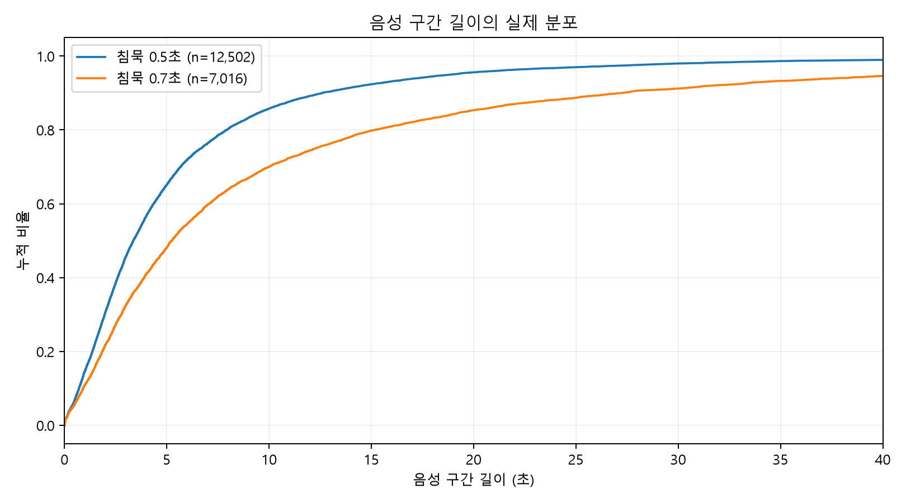
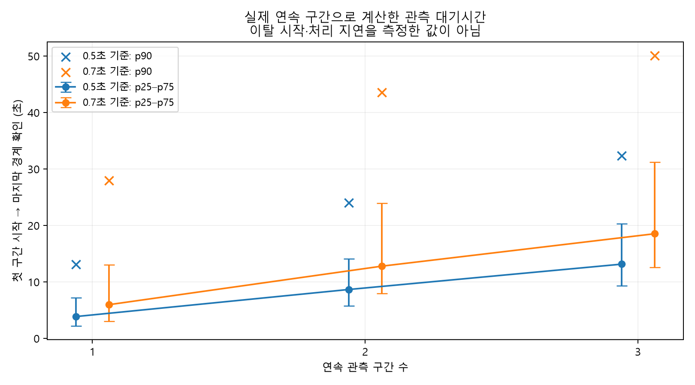
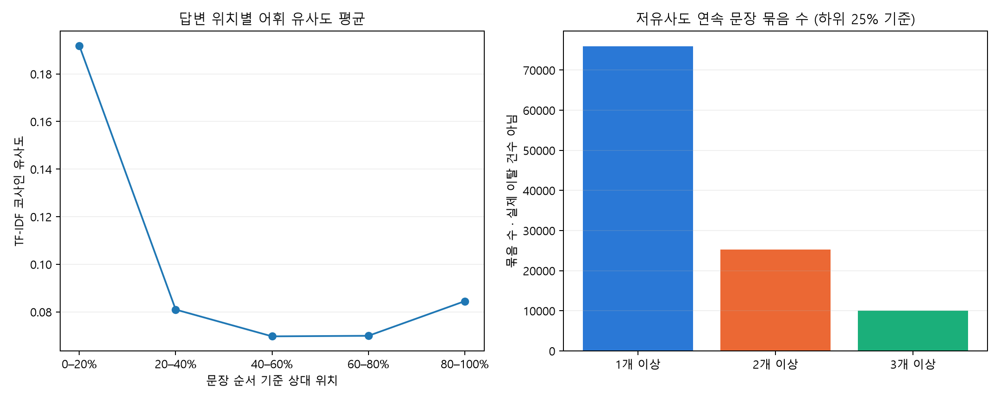
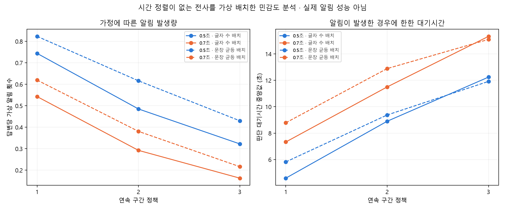

# 실시간 질문 이탈 알림의 초기 설계 후보

분석일: 2026-11-02 · 목적: 기획과 데이터 기반 설계 근거 · 실제 이탈의 최적 알림 시점은 미확인

## 1. 기존 데이터로 확인한 사실

AI Hub 「채용면접 인터뷰 데이터」의 기존 전사 76,105답변과 보유 음성 1,198쌍을 사용했다. 음성 시간 분석의 단위는 1,198개 **답변 WAV**이며 질문 WAV를 답변 구간 분포에 섞지 않았다. 전체 전사에서 480,098문장, 음성 보유 답변에서 6,751문장을 분석했다. 전체 전사와 음성 일부 표본의 결과를 구분한다.

기존 중앙값 약 3.4초/5.3초는 각각 3.36초/5.26초로 재현됐다. 기존 outputs/segments.csv와 파일별·순서별 구간 길이가 수치 허용오차 1e-9 이내로 일치한다. 원본 데이터, 기존 분석 스크립트와 기존 결과 파일은 변경하지 않았다.

이탈·복귀 정답, 알림 필요성 정답, 문장과 WAV의 시간 정렬은 없다. 기존 12파일 STT 전사의 모델 생성 시각은 이 1,198답변의 사람이 검증한 문장 시각이 아니다. 이번 분석에서는 새 모델 학습·STT·서비스 구현을 수행하지 않았다.

## 2. 음성 구간 지속시간

기존 방법과 동일한 25ms 에너지 창·10ms 간격, 파일별 max(p90−30dB, p10+6dB) 임계값을 사용했다. 첫·마지막 음성 프레임 바깥을 제외하고 0.5초/0.7초 이상의 무음에서 분할했다. 짧은 내부 쉼은 구간 길이에 포함하고 분할을 만든 긴 무음은 구간 길이에서 제외한다. 이는 에너지 기반 근사이며 의미 단위나 실제 문장 경계가 아니다. 전체 파일에서 임계값을 구하므로 온라인 VAD 지연을 실측한 것도 아니다.

구간별 길이 분포 (초, 구간을 동일 가중):

| 침묵 기준(초) | 총 구간 수 | 답변 수 | p25 | p50 | p75 | p90 |
| --- | --- | --- | --- | --- | --- | --- |
| 0.50 | 12,502 | 1,198 | 1.67 | 3.36 | 6.68 | 12.60 |
| 0.70 | 7,016 | 1,198 | 2.32 | 5.26 | 12.29 | 27.24 |

답변당 구간 수 분포 (개, 답변을 동일 가중):

| 침묵 기준(초) | 답변 수 | 총 구간 수 | 평균 | p25 | p50 | p75 | p90 |
| --- | --- | --- | --- | --- | --- | --- | --- |
| 0.50 | 1,198 | 12,502 | 10.44 | 5.00 | 9.00 | 15.00 | 20.00 |
| 0.70 | 1,198 | 7,016 | 5.86 | 2.00 | 4.00 | 8.00 | 12.00 |

0.7초 기준은 짧은 쉼을 더 많이 합치므로 구간 수는 줄고 긴 구간이 늘어난다. 0.5초 기준은 판단 기회가 많지만 문장이나 배경 설명을 잘라 볼 가능성이 있다. 이 분석만으로 어느 기준의 의미 판단이 더 정확한지는 알 수 없다.

## 3. 실제 연속 구간의 판단 대기시간

각 답변의 실제 순서를 보존해 겹치는 모든 1·2·3구간 창을 구성했다. 계산은 **마지막 구간 종료 시각 + 침묵 기준 − 첫 구간 시작 시각**이다. 창 내부의 경계 무음과 마지막 경계 확인용 침묵을 포함한다. 가상의 이탈이 첫 구간 시작과 같다고 가정한 실제 알림 지연이 아니라, 그 창을 관측할 때 필요한 시간이다. STT final 확정, 관련성 판단, 네트워크, UI 출력 지연은 포함하지 않았다.

첫 구간 시작부터 마지막 경계 확인까지 (초):

| 침묵 기준(초) | 연속 구간 수 | 창 수 | p25 | p50 | p75 | p90 |
| --- | --- | --- | --- | --- | --- | --- |
| 0.50 | 1 | 12,502 | 2.17 | 3.86 | 7.18 | 13.10 |
| 0.50 | 2 | 11,304 | 5.78 | 8.65 | 14.08 | 24.00 |
| 0.50 | 3 | 10,142 | 9.34 | 13.14 | 20.33 | 32.38 |
| 0.70 | 1 | 7,016 | 3.02 | 5.96 | 12.99 | 27.94 |
| 0.70 | 2 | 5,818 | 7.97 | 12.78 | 23.92 | 43.55 |
| 0.70 | 3 | 4,751 | 12.59 | 18.52 | 31.18 | 50.07 |

이번 WAV에는 마지막 구간 뒤에도 각 침묵 기준만큼 관측 프레임이 있어 경계 미확인 창은 0개였다. 파일 종료 신호를 사용해 침묵 대기 없이 확정하는 서비스라면 끝 구간의 시간이 달라진다. 프레임 시각은 10ms 해상도이며 25ms 창 처리 비용까지 실측한 값은 아니다.

중앙값을 곱하지 않았다. 예를 들어 0.5초 기준 2구간의 실제 내용 길이 합 중앙값은 7.28초, 내부 무음 포함 길이는 8.16초, 마지막 침묵 확인까지는 8.66초다. 3.36×2=6.72초와 다르다. **기존 보고서의 ‘중앙값×2가 최소 지연’이라는 표현은 설계 근거로 사용하지 않는다.** 실제 이탈은 구간 중간에 시작할 수 있고 충분히 짧아 알림 전에 종료될 수도 있다.

창 수는 1·2·3구간마다 다르며, 구간이 많은 답변에 가중치가 더 간다. 겹치는 창은 독립 표본이 아니다. 3구간 미만 답변은 3구간 비교에 들어가지 않는다. 따라서 정책별 동일 이탈 사건의 지연 비교나 모집단 추정이 아니다. 개별 창의 내용 합·무음 포함 길이·확인 시각은 consecutive_windows.csv에 남겼다.

## 4. 질문 관련성의 연속 변화

기존 분석과 동일하게 문자 char_wb 2~3-gram TF-IDF 코사인 유사도를 사용했다(min_df=5, sublinear_tf=True). 전체 질문·답변의 빈도로 어휘 가중치만 계산했다. 분류기나 의미 모델을 학습한 것이 아니며 점수는 관련성 확률이 아니다. 마침표·물음표·느낌표로 문장을 나누어 문장마다 자신의 질문과 비교했다. 문장부호 오류와 짧은 문장에 민감하다.

탐색용 주 기준은 전체 문장 점수의 하위 25% 경계 **0.017849 미만**이다. 정답에 맞춘 임계값이 아니며 저유사도 문장이 약 25% 생기도록 정한 통계 기준이다. 하위 10%·40%도 민감도 비교에 사용했다. 음성 일부에서도 같은 전체 임계값을 사용했다.

전체 480,098문장 중 저유사도는 120,025문장(25.0%)이다. 연속 저유사도 묶음은 75,919개이며, 2문장 이상은 25,244개, 3문장 이상은 9,991개다. 묶음 길이 중앙값은 1문장, p90은 3문장이다. 이후 점수가 기준 이상으로 다시 높아진 묶음은 60,513개(79.7%)였다. **이것은 실제 이탈 후 복귀율이 아니다.**

이전 문장이 저유사도일 때 다음 문장도 저유사도일 비율은 42.2%, 이전 문장이 기준 이상일 때 다음 문장이 저유사도일 비율은 23.1%다. 분모는 각 답변의 마지막 문장을 제외한 문장 전이이며 답변 사이를 잇지 않았다. 연속 패턴이 있음을 보여 주지만 이탈이 지속된다는 근거는 아니다.

음성 1,198답변의 6,751문장에서는 저유사도 비율 30.3%, 묶음 1,202개, 2문장 이상 481개, 3문장 이상 195개였다. 전체 텍스트와 음성 일부의 분포가 같다고 가정하지 않는다.

답변 위치는 초가 아니라 문장 순서의 (순번+0.5)/문장 수다. 위치별 평균·사분위는 position_summary.csv에 기록했다. 질문 단어를 초반에 반복하고 뒤에서 구체적 사례를 드는 정상 답변도 유사도가 낮아질 수 있다. 정상 배경 설명, 간접 답변, 동의어·대명사 사용과 실제 이탈을 이 점수만으로 구분할 수 없다. 사람 검수 없이 낮은 점수의 문장을 실제 이탈 예시로 제시하지 않는다.

## 5. 초기 정책 비교: 측정 가능한 것과 미확인 값

| 후보 | 비교 가능한 값 | 기대하는 장점 | 설계상 비용·한계 |
| --- | --- | --- | --- |
| 1구간 후보 후 알림 | 음성 1구간 시간 분포; 후보 신호를 가정한 출력 횟수 | 적은 관측량으로 판단 가능 | 일시적인 배경 설명에도 반응할 가능성; 긴 1구간이면 이미 늦음 |
| 연속 2구간 후보 후 알림 | 실제 2구간 창 분포; 가상 후보 묶음 중 2구간 이상 수 | 단발 후보를 보류하는 중간안 | 1구간으로 끝난 실제 이탈도 놓칠 가능성; 분할 기준에 시간 의존 |
| 연속 3구간 후보 후 알림 | 실제 3구간 창 분포; 가상 후보 묶음 중 3구간 이상 수 | 짧은 후보 묶음을 더 많이 보류 | 판단 대기가 길어지고 짧은 답변에 기회가 적음 |
| 후보 내용 누적 5·10·15초 | 가상 후보 구간의 길이 합과 경계별 도달 여부 | 구간 개수 차이를 시간으로 보완 | 구간 확정 후 판단하면 문턱보다 늦음; 문턱은 검증 전 탐색값 |
| 후보 시작 후 경과 5·10·15초 | 시각 정렬과 실제 후보 이벤트가 있으면 계산 가능 | 긴 후보 구간에서도 중간 판단 가능 | 무음만으로 타이머가 찰 수 있음; 지속적 관련성 확인·partial 안정성 필요 |

정확도, 정밀도, 재현율, 오탐률, 미탐률, 실제 이탈 시작부터 알림까지의 지연, 알림의 유용성·방해 정도, 최적 임계값은 **현재 정답 라벨로 확인할 수 없다.** 연속 2·3구간에서 가상 알림이 감소해도 오탐 감소나 정확도 향상으로 부르지 않는다.

이번 시간 정책의 시뮬레이션은 ‘후보로 분류된 확정 구간의 길이 합’을 사용했다. 짧은 내부 쉼은 포함하고 분할 경계의 긴 무음은 제외한다. 순수 유성음 누적시간도, 첫 후보 이후 전체 경과시간도 아니다. 기준 이상 구간이 나오면 합을 0으로 초기화한다. 한 후보 묶음에서 1회만 알리고 그 묶음이 끝날 때까지 재알림하지 않는다. 별도 cooldown은 0이며 실제 UI에는 적용하지 않았다.

## 6. 시뮬레이션 A: 실제 문장 순서만 사용한 횟수

저유사도 문장을 후보로 가정하고 같은 묶음에서 1회만 알리는 정책이다. 다음 기준 이상 문장에서 초기화한다. 이는 실제 문장 순서에 대한 규칙 계산이며, **문장 수는 음성 구간 수가 아니다.** 문장 시각이 없어 초 단위 대기시간은 계산하지 않았다.

| 대상 | 연속 문장 수 | 가상 알림 수 | 해당 답변 수 | 답변당 횟수 |
| --- | --- | --- | --- | --- |
| all | 1 | 75,919 | 47,902 | 1.00 |
| all | 2 | 25,244 | 21,272 | 0.33 |
| all | 3 | 9,991 | 9,330 | 0.13 |
| audio1198 | 1 | 1,202 | 803 | 1.00 |
| audio1198 | 2 | 481 | 411 | 0.40 |
| audio1198 | 3 | 195 | 184 | 0.16 |

## 7. 시뮬레이션 B: 음성 시간과 전사의 가상 결합

실제 음성 구간의 시간과 문장 점수를 결합하려면 정렬이 필요하다. 정렬이 없어 두 가지 가정을 비교했다. (1) 문장 글자 수 비례로 전체 음성 구간 길이 합에 배치, (2) 문장마다 같은 길이로 배치. 긴 경계 침묵을 뺀 축에서 배치한 뒤 실제 WAV의 구간 시각으로 되돌렸다. 두 방법 모두 발화 속도 변화와 문장·침묵 경계 불일치를 복원하지 못하는 **가상 배치**다.

구간 내용 시간의 50% 이상이 저유사도 문장과 겹치면 해당 구간을 후보로 설정했다. 50% 역시 임의의 집계 기준이다. 실제 서비스에서 관측한 후보 신호가 아니며 실제 음성 구간의 의미 판정도 아니다. 한 묶음당 1회, 기준 이상 구간이 나오면 초기화, 1,198개 답변 전체를 분모로 사용했다. 기회를 채우지 못한 답변과 후보가 없는 답변도 분모에 포함한다. 최소 어절 수나 별도 cooldown은 적용하지 않아 기존 구현의 가상 알림 로그와 동일한 정책이 아니다.

주 시나리오: 하위 25% · 글자 수 비례 배치. 횟수와 대기시간 모두 **가정 기반 결과**다. p25~p90의 단위는 초이며, 대기는 가상 후보 묶음 첫 구간 시작부터 알림 조건을 충족한 구간의 침묵 경계 확인까지다.

| 침묵 기준(초) | 정책 | 가상 알림 수 | 해당 답변 수 | 답변당 횟수 | p25 | p50 | p75 | p90 |
| --- | --- | --- | --- | --- | --- | --- | --- | --- |
| 0.50 | 누적 5초 | 702 | 576 | 0.59 | 7.76 | 9.97 | 13.74 | 21.97 |
| 0.50 | 누적 10초 | 523 | 461 | 0.44 | 13.14 | 15.44 | 19.30 | 27.05 |
| 0.50 | 누적 15초 | 357 | 337 | 0.30 | 19.40 | 22.16 | 26.13 | 37.75 |
| 0.50 | 연속 1구간 | 891 | 683 | 0.74 | 2.28 | 4.59 | 10.04 | 17.83 |
| 0.50 | 연속 2구간 | 581 | 488 | 0.48 | 5.95 | 8.90 | 15.03 | 25.91 |
| 0.50 | 연속 3구간 | 386 | 338 | 0.32 | 8.64 | 12.24 | 19.29 | 31.27 |
| 0.70 | 누적 5초 | 537 | 465 | 0.45 | 8.63 | 12.63 | 23.34 | 45.76 |
| 0.70 | 누적 10초 | 423 | 387 | 0.35 | 14.61 | 18.72 | 29.78 | 54.62 |
| 0.70 | 누적 15초 | 329 | 311 | 0.27 | 20.57 | 25.12 | 37.37 | 60.00 |
| 0.70 | 연속 1구간 | 650 | 535 | 0.54 | 3.12 | 7.33 | 18.46 | 37.39 |
| 0.70 | 연속 2구간 | 350 | 299 | 0.29 | 7.33 | 11.50 | 24.25 | 44.07 |
| 0.70 | 연속 3구간 | 195 | 177 | 0.16 | 10.64 | 15.33 | 27.48 | 47.81 |

각 정책의 시간 분포는 그 정책에서 알림이 발생한 사건만의 조건부 분포다. 3구간·15초 정책은 짧은 묶음을 제외하므로 서로 다른 사건 집합을 비교한다. 시간 문턱을 넘어도 다음 구간 확정까지 기다리는 정책이라 10초 정책이 정확히 10초에 알리는 것은 아니다. 표의 시간은 실제 이탈 감지 지연이 아니다.

연속 2구간 정책의 가정·임계값 민감도:

| 시간 배치 가정 | 침묵 기준 | 하위 분위 | 가상 알림 수 | 답변당 횟수 | p50 | p90 |
| --- | --- | --- | --- | --- | --- | --- |
| characters | 0.50 | 0.10 | 288 | 0.24 | 7.71 | 22.27 |
| characters | 0.50 | 0.25 | 581 | 0.48 | 8.90 | 25.91 |
| characters | 0.50 | 0.40 | 815 | 0.68 | 9.77 | 31.87 |
| characters | 0.70 | 0.10 | 174 | 0.15 | 10.03 | 40.25 |
| characters | 0.70 | 0.25 | 350 | 0.29 | 11.50 | 44.07 |
| characters | 0.70 | 0.40 | 512 | 0.43 | 13.93 | 52.15 |
| equal_sentences | 0.50 | 0.10 | 447 | 0.37 | 9.20 | 23.11 |
| equal_sentences | 0.50 | 0.25 | 738 | 0.62 | 9.38 | 26.68 |
| equal_sentences | 0.50 | 0.40 | 947 | 0.79 | 10.36 | 31.85 |
| equal_sentences | 0.70 | 0.10 | 264 | 0.22 | 11.57 | 35.68 |
| equal_sentences | 0.70 | 0.25 | 456 | 0.38 | 12.89 | 44.62 |
| equal_sentences | 0.70 | 0.40 | 572 | 0.48 | 14.11 | 51.34 |

전체 72개 조합(침묵 2 × 배치 2 × 점수 경계 3 × 정책 6)은 simulation_summary.csv에 제공한다. 가정에 따른 변동은 신뢰구간이나 실제 성능 범위가 아니다. 실제 STT 오류, 처리 지연, 후보 점수의 불확실성과 이탈이 시작된 시점은 시뮬레이션에 없다.

## 8. 초기 설계 후보와 사용자 평가

**우선 비교할 중간 후보는 0.5초 분할·연속 2구간과 후보 내용 누적 10초다.** 두 값 모두 최적값이나 출시 권고가 아니다. 0.5초 기준은 0.7초보다 관측 기회가 많고 2구간은 단발 후보를 보류하므로 빠른 알림과 보류 사이의 초기 비교점으로 삼는다. 누적 10초는 구간 개수의 시간 변동을 비교할 대안으로 삼고, 5초·15초를 함께 비교한다. 1구간·3구간도 알림량과 방해감의 양끝 비교 조건으로 유지한다. 이 후보 선정은 성능 검증 결과가 아니라 데이터의 시간 규모와 정책 구조에 따른 기획 판단이다.

발표 문장: “음성 1,198답변의 구간 분포와 전사 저유사도 연속 패턴을 분석해 알림 정책의 초기 비교안을 만들었다. 0.5초 분할의 연속 2구간 관측 대기는 중앙값 8.66초였으나, 실제 이탈 시작부터의 알림 지연이나 최적 시점은 아직 검증하지 않았다.”

사용자 평가는 기존 20명×4유형=80녹음 계획과 연결하되, 정상 배경 설명과 일시적 다른 주제 후 복귀를 반드시 포함한다. 2명의 평가자가 음성을 듣고 질문 요구사항, 이탈 시작·복귀, 알림 필요 여부와 허용 시간창을 독립적으로 표시하고 불일치를 합의한다. 이탈 필요성을 강제로 확정하기 어려운 구간은 불확실로 남긴다. 문장·음성 시간 정렬을 검수한 후 같은 녹음·같은 후보 점수에 정책만 바꿔 재생 비교한다.

실제 이탈 정답이 확보되면 사건별 정밀도·재현율, 정상 답변의 불필요 알림 수/분, 이탈 시작부터 알림까지 시간, 허용 시간창 안 알림률, 끝내 알림이 없는 이탈 비율을 비교한다. 미알림 사건을 지연 통계에서 숨기지 말고 별도로 보고한다. STT final·판단·UI 지연도 별도 계측한다. 참가자에게는 방해감, 유용성, 답변 흐름 유지, 복귀 도움과 정책 선호를 묻는다.

순서 효과를 줄이도록 정책 제시 순서를 균형 배정한다. 실제 이탈과 연기한 이탈을 구분하고, 같은 사람·같은 의미 질문이 개발과 최종 평가에 겹치지 않게 한다. 80건은 초기 비교용 소규모 계획이며 시간 문턱의 일반적 최적값을 확정할 근거로 삼지 않는다. 사람 검수 48개 보류와 실제 신규 녹음 0건이라는 기존 상태는 변경하지 않았다.

## 9. 발표 자료와 재현

그래프 4종은 PNG(발표 삽입용)와 SVG(편집용)로 제공한다. 표는 segment_summary.csv, segments_per_answer.csv, window_summary.csv, relevance_summary.csv, transitions.csv, position_summary.csv, sentence_policy_counts.csv, simulation_summary.csv에 있다. 공개 웹사이트에는 집계표와 그래프만 추가하며 원문 전사·음성·개인별 점수는 올리지 않는다.

재현: 기존 Python 3.12 런타임으로 alert_timing_20261102/analyze.py 실행 후 build_report.py 실행. 의존성은 기존 verification_20261029/packages를 사용한다. 임계값·패키지 버전은 analysis_metadata.json, 실제 실행 경과는 run.log, 원본 보존 대조는 preservation_check.json에 기록한다.
