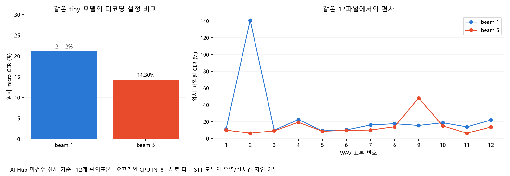

# 중간발표 통합 보고서 — 데이터·실제 실행·수집 계획

기준일: 2026-10-29. 기존 분석/재현 검증/수집 계획은 유지하며 최신 실행 결과를 추가했다. **48개 사람 검수는 보류**, 사람 완료 0개·신규 녹음 0개다. 모델 시험은 API 요금 없는 로컬 CPU에서만 수행했고 음성은 외부로 전송하지 않았다.

## 1. 현재 무엇이 끝났는가

| 영역 | 실제 수행 결과 | 상태·발표 시 해석 |
|---|---|---|
| 기존 분석 | JSON 원본 76,106개 중 분석 76,105개, 음성 1,198쌍·약 27.254시간 | 보유 데이터·분모 확인 완료 |
| 재현성 | 네 분석 재실행, 12개 산출물 중 11개 바이트 동일·1개 행순서 차이만 있음 | 기존 수치의 계산 재현 완료 |
| 품질 선별 | 자동 통과 후보 75,983개·검수 필요 122개 | 사람 품질 승인 아님 |
| 중복·분할 | 분할 간 정규화 동일 질문 87개 그룹 발견 | 실제 학습·평가 전에 질문군 분리 필요 |
| 사람 검수 | 275개·48개 표본과 입력 도구 준비 | 사용자 요청으로 보류, 실제 정답 없음 |
| STT 실행 | 아래 tiny 모델의 12파일 × 2개 디코딩 설정 실제 실행 | 미검수 전사 기준 임시 CER·오프라인 속도 |
| 질문 구분 기준선 | 질문 그룹 분리 후 어휘 모델 학습·테스트 | 원래 질문 쌍 구분 과제, 실제 이탈 성능 아님 |
| 수집·평가 설계 | 80건 시나리오·순서 균형·시간 라벨·분할 검사 코드 | 계획 완료, 녹음·의미 질문군 검수는 미완료 |
| STAR·성장 | 기존 규칙 결과와 평가 계획 보존 | 사람 STAR 정답·반복 연습 전후 데이터 없음 |

## 2. 새로 실제 수행한 무료 STT 시험

공개 다국어 모델 `Systran/faster-whisper-tiny`의 고정 revision `d90ca5fe260221311c53c58e660288d3deb8d356`을 사용했다. 모델 자산 78,203,619바이트(약 78.2MB)를 별도 폴더에 내려받았다. 원본 WAV는 수정하지 않았다. CPU 4스레드·INT8·language=ko·temperature=0·VAD off로 두 beam 설정을 번갈아 먼저 실행했다. 1초 합성 무음으로 워밍업했고 모델 로딩·파일 읽기·워밍업은 디코딩 시간에서 제외했다. **모델은 하나이며 beam 1/5는 디코딩 설정 비교다.**

6개 보유 하위셋에서 2개씩 선택한 12개 WAV, 총 약 14.4732분을 같은 순서로 사용했다. CER 정규화는 NFC·소문자·공백/문장부호 제거이며 간투사는 삭제하지 않았다. 각 설정/파일당 1회 실행이다. 원본 전사는 사람이 청취 검수하지 않았으므로 아래 CER는 모두 **임시 참고치**다.

| 같은 tiny 모델 설정 | 파일 수 | 임시 micro CER | 임시 macro CER | 디코딩 합계 | 실시간율 RTF |
|---|---:|---:|---:|---:|---:|
| tiny INT8 beam 1 | 12 | 21.12% | 25.50% | 81.97초 | 0.0944 |
| tiny INT8 beam 5 | 12 | 14.30% | 14.04% | 137.40초 | 0.1582 |

micro는 오류 문자 합/정답 문자 합, macro는 파일별 CER 평균이다. RTF는 디코딩 시간/음성 길이이며 작은 값이 빠른 오프라인 처리를 의미한다. 두 값 모두 실시간 서비스의 partial/final 지연시간이 아니다. 이 PC의 단일 실행이라 장비·재실행 변동에 대한 통계적 결론은 내리지 않는다. beam 5는 이번 표본에서 임시 CER가 낮고 시간이 더 들었다. 다른 STT 모델보다 우수하다는 뜻은 아니다.

실행 일부 시간에는 질문 쌍 기준선 분석도 같은 PC에서 진행했으므로 CPU 자원 경합이 처리시간에 영향을 줄 수 있다. 정밀 속도 벤치마크가 필요하면 다른 작업을 중단하고 설정별 반복 측정을 해야 한다.

AI Hub 전사의 독립 어절 ‘어/음’ 후보는 34개였고 두 설정 모두 문자 정렬에서 보존된 후보는 0개였다. 이 결과는 **자동 표기 후보의 정렬 참고치**이며, 실제 간투사 이벤트의 사람 정답 Recall/Precision이 아니다. 간투사 기반 유창성 기능에서는 전사 정규화·모델의 생략 여부를 별도 청취 검증해야 함을 보여 주는 점검 항목으로 사용한다.

시작 시 PyAV 19와 faster-whisper의 `metadata_errors` 인자 호환 문제가 발생했다. 원본을 바꾸거나 실패를 성공으로 처리하지 않고, 확인된 PCM16·16kHz WAV를 Python 표준 wave로 읽어 float32 배열로 전달해 실행했다. 실패 로그와 빈 시작 파일도 남겼다. 성공 결과는 `local_stt_predictions_run1.jsonl` 24행이며 `stt_summary.json`에 환경·실측 수치가 있다.

## 3. STT 후보 비교에서 아는 것과 모르는 것

| 후보 | 실제 확인한 기능 | 이 프로젝트 실제 측정 | 다음 조건 |
|---|---|---|---|
| 로컬 faster-whisper + tiny | CPU INT8 한국어 파일 전사 실행 | 위 12파일·2설정 임시 CER 및 처리시간 | 검수 정답·다른 모델·라이브 청크는 미검증 |
| Google Chirp 3 | 공식 ko-KR 및 스트리밍 지원 | 미실행·CER/간투사/지연 미측정 | 인증·과금·데이터 외부 전송 범위 확인 후 |
| Azure Speech | 공식 ko-KR·연속 스트림 인식 지원 | 미실행·CER/간투사/지연 미측정 | 인증·리전 단가·외부 전송 범위 확인 후 |

지원 기능은 [faster-whisper 공식 저장소](https://github.com/SYSTRAN/faster-whisper), [tiny 공개 파일](https://huggingface.co/Systran/faster-whisper-tiny/tree/main), [Google Chirp 3](https://docs.cloud.google.com/speech-to-text/docs/models/chirp-3), [Azure 언어 지원](https://learn.microsoft.com/en-us/azure/ai-services/speech-service/language-support?tabs=stt)을 근거로 했다. 비용 확인 범위와 클라우드용 코드는 이전 단계 STT 계획에 보존했다. 이번 실제 유료 API 호출은 0건이며 모델 가중치 취득 후 추론도 오프라인으로 실행했다.

## 4. 질문 이탈 감지 구현 검토와 무료 기준선

현재 구현한 것은 ‘의미 이탈 모델’이 아니라 **TF-IDF 코사인+단어 포함 비율 → 로지스틱 회귀 → 경보 상태기계**의 작은 어휘 기준선이다. 질문 의도를 실제로 유지했는지의 정답은 없다.

- Training 답변 2,000개에서 원래 질문/같은 규칙 유형의 다른 질문 쌍 4,000개를 만들었다.
- Validation에서 Training 전체와 정규화 질문이 겹치지 않는 고유 질문 800개를 골라 개발 400개·테스트 400개로 분리했다. 테스트는 800쌍이고 분할 간 정규화 질문 중복은 0개다. 화자 독립성은 미확인이다.
- 어휘/모델은 Training 부분집합만 보고, 이진 쌍 판정 임계값 0.35는 개발에서 선택했다.
- **질문 쌍 구분** 테스트 AUC: 로지스틱 기준선 **0.9147**, 코사인 단독 **0.9278**. 쌍 판정 F1은 0.8585다. 추가 분류기가 코사인 단독보다 나아졌다는 근거는 이번 AUC에서 얻지 못했다.

이 과제는 원래 질문의 식별이며 원래 답변의 관련성도 사람이 검수하지 않았다. **실제 이탈 감지 AUC·Recall·오알림·알림 지연으로 발표하면 안 된다.** 기존 전체 코퍼스 TF-IDF AUC 0.969/문장 0.766과는 데이터·분할·부정 쌍이 달라 직접 우열 비교하지 않는다.

경보 코드의 출발값은 final 구간, 5어절 이상, 점수 0.2/0.8, 연속 2구간, cooldown 15초다. 불확실 구간은 알림을 억제한다. 이 값과 whole-answer 학습 점수의 구간 적용은 아직 검증되지 않았다. 실제 tiny 구간으로 오프라인 재생 로그를 만들었지만, 이는 사용자에게 알림을 보내거나 실시간 성능을 측정한 것이 아니다.

## 5. 서비스 구현 흐름과 데이터 연결

| 처리 단계 | 사용할 데이터·구현 | 현재 검증 범위 | 추가로 필요한 것 |
|---|---|---|---|
| 음성 수집 | PCM 프레임+도착 시각 | 보유 WAV 형식·길이 | 신규 마이크 환경·동의·실제 도착 로그 |
| VAD·STT·확정 | 온라인 VAD, partial/final 분리, 중복 제거 | 오프라인 침묵 분석·tiny 파일 전사 | 미래정보 없는 VAD·스트리밍 지연 시험 |
| 질문 핵심+누적 답변 | 요구 항목·최근 문맥·누적 요약 | 질문 유형 규칙·어휘 기준선 | 질문별 루브릭·의미 판단 모델·정답 |
| 이탈 알림 | 불확실 억제·연속 N구간·cooldown | 상태기계·오프라인 재생 | 이탈/복귀/알림 허용창 시간 라벨 |
| STAR·유창성 | 근거 구간·간투사·속도·쉼 | 규칙 통계·음향 특징 | 사람 STAR·간투사 정답 |
| 성장 리포트 | 동일 화자·질문 전후 비교 | 계획 | 자연 답변→피드백→재답변 녹음 |

## 6. 추가 수집 계획과 발표 범위

기존 80건 계획은 유지한다. 정상/지속 이탈/일시 이탈/STAR 누락 각각 20건이며 개발 32·검증 16·테스트 32건이다. 순서 균형·기억 효과 기록·연기/자연 이탈 구분·화자/질문군 분리 검토를 보존했다. 실제 녹음은 0건이고 테스트 유형별 8건은 작은 표본이다. 48개 검수는 보류하며 자동으로 완료 처리하지 않는다.

11월 6일 발표에는 **① 확보·재현 결과 ② 실제 무료 STT 시험과 한계 ③ 독립 질문군 기준선의 평가 과제 ④ 신규 시간 정답의 수집·평가 계획**을 제시할 수 있다. 실제 사용자 이탈 정확도·검수 완료 수·성장 효과·클라우드 성능은 아직 제시할 수 없다.

## 7. 웹사이트와 Claude Artifact

현재 웹사이트는 PC의 독립 HTML이며 원격 Claude Artifact와 자동 동기화하지 않는다. Artifact 원격 링크/원본이 없어 원격 상태는 확인하지 못했고, 원격 Artifact를 수정·게시하지 않았다. 전달용 `report/integrated_standalone.html`에는 그래프와 보고서를 포함해 상대경로 의존을 줄였다. 기존 Artifact 대화에서 이 파일과 본 보고서를 첨부해 해당 Artifact의 수정/새 버전을 요청할 수 있다. 기존 Artifact 종류·권한에 따라 직접 수정 대신 복사본이 될 수 있다. 자세한 절차와 전달 요청문은 `Claude_Artifact_반영안내.md`에 있다.

## 8. 생성·보존

기존 data·src·outputs·1/2단계 문서는 유지했다. 기존 웹사이트는 작업 전 `backup/index.html`에 보관하고 새 통합 현황·실행 결과·구현/Artifact 안내를 추가했다. 새 코드·모델·런타임·결과·로그는 `phase3_integrated_20261029/`에만 두었다. 원문 전사·예측 전문은 로컬 결과 파일에 있고 새 웹 섹션에는 집계만 표시한다. 실행 재현·파일 목록은 `README.md`에 정리한다.

# 한국어 STT·질문 이탈 감지 구현과 평가 범위

작성 기준: 2026-10-29. 사람 검수 48개는 사용자 요청에 따라 보류한다. 도구와 표본은 그대로 보존하며 완료 수를 늘리지 않는다.

## 1. 완료된 것과 부족한 것

| 영역 | 실제 수행한 일 | 아직 부족하거나 미실행인 일 |
|---|---|---|
| 데이터 확보·특성 | 라벨 76,106개 중 76,105개 분석, 실제 음성 1,198쌍 확인 | 전체 음성 확보·화자 ID 확인·실서비스 환경 대표성 |
| 재현 검증 | 네 분석 재실행, 12개 산출물 내용 일치 | 사람이 판단한 품질·기능 정확도 검증과는 별개 |
| 활용 선별 | 자동 통과 후보 75,983개·품질 검수 필요 122개, 275개 및 48개 검수 표본 | 질문 유형·STAR 적합성·QA 의미·전사 청취 검수는 보류 |
| 신규 수집 | 80건 배분·라벨 양식·순서 균형·분할 검사 코드 | 실제 녹음 0건, 의미 질문군·실제 참여자 중복 검수 |
| STT | 이번 단계의 로컬 tiny 실제 실행 결과는 통합 보고서 표 참조 | 다른 모델/클라우드 직접 비교, 검수 전사 기준 CER, 간투사 정답, 실제 라이브 지연 |
| 이탈 감지 | 질문 그룹을 분리한 어휘 기준선 학습·평가와 경보 상태기계 코드 | 실제 이탈 시작·복귀·알림 허용창 정답, 의미 모델 검증, 실제 사용자 알림 평가 |
| STAR·성장 | 기존 규칙·후속 평가 설계 | S/T/A/R 사람 정답과 반복 연습 전후 녹음 |

## 2. STT 후보와 실행 우선순위

로컬 다국어 Whisper를 faster-whisper CPU INT8로 실행하는 경로는 API 요금 없이 원본 음성을 PC 안에서 처리한다. 모델·런타임은 공개 파일을 다운로드해 프로젝트의 별도 폴더에 저장한다. 이번에는 약 78MB의 tiny만 내려받았고 대형 모델이나 유료 API는 사용하지 않았다. 같은 tiny의 beam 1과 5를 비교한 것은 **디코딩 설정 비교**이며 서로 다른 STT 모델 두 개의 성능 비교가 아니다.

한국어 `ko-KR`를 지원하는 Google Chirp 3·Azure Speech는 실시간 스트림 비교 후보로 유지한다. 지원 기능·가격 확인 범위는 이전 `STT_비교_실험계획.md`에 공식 출처와 함께 정리돼 있다. 해당 문서의 ‘모든 STT 미실행’은 2단계 작성 당시의 기록이며 최신 로컬 실행은 3단계 결과로 구분한다. 클라우드 호출은 여전히 미실행이다.

tiny가 통합 보고서에서 낮은 임시 CER를 보이더라도 최종 모델로 확정하지 않는다. 12개는 편의표본이고 전사 정답이 미검수이며 환경 다양성이 부족하다. 다음 실제 비교는 같은 표본·정규화·검수된 전사를 사용해 다른 로컬 모델이나 승인된 클라우드와 진행한다. 비용 없는 후속 모델도 대용량 다운로드는 별도 범위 확인 후 한다.

## 3. 구현할 데이터 처리 흐름

1. **오디오 수집:** 분석용 PCM16·mono·16kHz 프레임을 수신하고 첫 샘플 기준 시간과 실제 도착 monotonic 시각을 기록한다. 원본은 따로 보존한다.
2. **온라인 VAD·구간 확정:** 미래 프레임을 보지 않는 VAD로 침묵 0.5/0.7초와 최대 10/15초 조건을 시험한다. 기존 분석의 파일 전체 에너지 백분위를 실시간 임계값으로 그대로 쓰지 않는다.
3. **STT:** partial은 화면 표시용, 안정된 final을 판단용으로 분리한다. 중첩 청크에서는 중복 전사를 제거하고 간투사·반복을 원문에 보존한다. tiny 파일 전체 시험은 이 스트리밍 단계를 구현한 결과가 아니다.
4. **질문 핵심 항목:** 질문당 사람이 확정한 요구(예: 갈등 맥락·본인 역할·해결 행동·결과)를 별도 저장한다. 질문 유형별로 STAR를 요구할지 구분한다. 현재 후보 스키마는 있지만 사람 확정 루브릭은 미완성이다.
5. **누적 문맥·의미 판단:** 최근 확정 구간 + 직전 문맥 + 답변 누적 요약을 이용해 `관련`, `이탈 후보`, `근거 부족`을 구분하고 근거 구절을 남긴다. 키워드가 줄었다는 이유만으로 이탈로 단정하지 않는다. 임베딩/재순위 모델 또는 LLM의 의미 판단은 후속 구현·검증 대상이다.
6. **알림 정책:** 확정 구간이 충분히 길고 이탈 후보가 연속 N개일 때만 알림 후보를 만든다. 불확실·부분 전사·짧은 배경 설명은 억제하고, 알림 후 cooldown을 둔다. STAR 누락은 답변 종료 후 구조 피드백으로 분리한다.
7. **종료 후 보고서:** 최종 전사·핵심 항목 충족·유창성 특징·STAR 근거를 함께 제시한다. 사람 평가 전 ‘좋은/나쁜 답변’의 객관적 점수로 만들지 않는다.

## 4. 이번에 실제 구현한 작은 기준선

`run_intent_baseline.py`는 Training에서 답변 2,000개를 뽑아 문자 TF-IDF 어휘와 2개 특징(질문–답변 코사인, 질문 단어 포함 비율)을 학습한다. 같은 규칙 유형에서 다른 질문을 골라 부정 쌍을 만들고 로지스틱 회귀를 적합한다. Validation 중 Training 전체에 등장하지 않는 정규화 질문을 골라 개발/테스트를 각각 최대 400개 고유 질문으로 분리한다. 어휘·모델은 Training 부분집합만 보고, 쌍 판정 임계값은 개발에서 정한다.

테스트에서 측정하는 것은 ‘원래 질문 쌍 / 같은 유형의 다른 질문 쌍’ 구분이다. 원래 답변이 실제로 관련 있는지도 사람 검수하지 않았고, 다른 질문이 반드시 의미적으로 무관한 것도 아니다. 그러므로 **질문 이탈 Precision/Recall/F1가 아니며 실제 이탈 AUC도 아니다.** 화자 독립성도 확인되지 않았다. 기존 전체 코퍼스 적합 TF-IDF AUC와는 표본·분할·부정 예시가 달라 단순 우열 비교하지 않는다.

`intent_guard.py`에는 final 여부, 최소 5어절, 낮음/높음 0.2/0.8, 연속 2구간, 15초 cooldown의 상태기계를 구현했다. 이 값은 실험 출발점이며 검증된 최적 정책이 아니다. 모델의 `pair_match_score`는 문장 이탈 확률로 보정되지 않았다. 이 기준선을 그대로 실서비스에 사용하면 질문 표현과 다른 정상 사례를 이탈로 잘못 알릴 수 있다.

실제 tiny 전사의 구간을 `replay_guard.py`에 넣는 재생은 **오프라인 문장/구간 재생**이다. ASR가 음성 전체를 먼저 본 뒤 생성한 구간이고 사람 이탈 라벨도 없으므로 실제 알림 지연·오알림률을 계산하지 않는다. `would_alert`는 가상 정책 후보일 뿐 사용자에게 전달된 알림이 아니다.

## 5. 최소 평가 데이터와 중간발표 범위

기존 AI Hub WAV는 STT 전사 비교와 음향 실험에 사용할 수 있다. 그러나 이탈 시작·끝·복귀·알림 허용창, STAR 정답은 없다. 그 지표를 측정하려면 기존 80건 계획의 실제 녹음과 시간 정답이 필요하다. 사람이 보류한 48개 검수를 AI가 대신 완료한 것으로 만들지 않는다.

발표에서는 ‘재현한 통계’, ‘실제로 실행한 tiny 전사’, ‘분리된 질문 쌍 기준선’, ‘검증 전 구현 정책’, ‘추가 수집 필요 데이터’를 각각 구분한다. CER는 AI Hub 미검수 전사 기준 참고치, 속도는 오프라인 CPU 처리시간, 간투사는 정답 검수 전 문자표기 후보 근사라는 단서를 같은 표에 둔다.

# 로컬 HTML과 Claude Artifact의 관계 및 반영 방법

확인일: 2026-10-29.

## 1. 지금 수정한 대상

현재 수정한 것은 이 PC 프로젝트의 `report/index.html`과 관련 로컬 파일이다. CSS·JavaScript·정적 수치가 있는 독립 HTML이며 Claude Artifact ID·원격 저장 API·자동 동기화 코드는 찾지 못했다. 따라서 **이번 로컬 수정이 기존 Claude Artifact에 자동 반영되지는 않는다.** 원래 HTML이 Artifact에서 내려받은 것인지, 원격 Artifact가 지금 어떤 버전인지는 링크·원격 원본을 받지 않아 확인하지 못했다. 기존 Claude Artifact 자체를 수정하거나 게시한 작업도 없다.

공식 안내상 Artifact는 Claude 대화 옆에서 열어 수정할 수 있으며, 종류에 따라 내보내기 또는 코드 복사/다운로드를 제공한다. 계정·Artifact 종류에 따라 화면과 편집 방법이 다르므로 현재 보이는 메뉴를 기준으로 진행한다. 출처: [Claude 공식 Artifact 안내](https://support.claude.com/en/articles/17153992-what-are-artifacts-and-how-do-i-use-them).

## 2. 기존 Artifact에 수정 내용을 반영하는 순서

1. 기존 Artifact가 있는 Claude 대화와 해당 Artifact를 연다. 먼저 코드/HTML을 다운로드하거나 내보내 기존 버전을 보관한다.
2. 이번에 만든 **`report/integrated_standalone.html`**과 이 폴더의 **`통합_결과보고서.md`**를 그 대화에 첨부한다. 로컬 index에는 상대경로 이미지·다른 문서 링크가 있어 그대로 복사하면 깨질 수 있으므로 이미지와 보고서를 포함한 단일 HTML을 사용한다.
3. 아래 요청문으로 ‘현재 열려 있는 기존 Artifact’를 수정해 달라고 요청한다. 기존 Artifact 편집 권한이나 형식 때문에 직접 수정할 수 없다면 새 버전/복사본으로 만들고 원본은 보존한다. 새 대화에서 코드로 다시 만든 경우 원래 Artifact와 별개임을 표시한다.
4. 반영 후 수치·상태·목차·그래프를 비교한다. 48개 검수는 보류, 신규 녹음은 미수집, 클라우드 STT는 미실행이라는 구분을 유지한다.
5. 다른 사람에게 보여 줄 필요가 있을 때만 공유 설정을 검토한다. 계정·조직·Artifact 종류에 따라 공유/게시 동작이 다르므로 자동 재게시된다고 가정하지 않는다. 출처: [Claude 공식 공유 안내](https://support.claude.com/en/articles/9547008-share-artifacts).

## 3. Claude에 전달할 요청문

> 첨부한 integrated_standalone.html은 로컬 프로젝트에서 기존 분석을 보존하면서 최신 실행 결과를 통합한 보고서입니다. 현재 대화의 기존 면접코치 데이터 분석 Artifact를 수정 대상으로 삼아 주세요. 기존 디자인·분석·검증·80건 수집 계획은 유지하고 최신 통합 현황과 실제 로컬 STT/질문 쌍 기준선 결과를 반영해 주세요. ‘실행 완료/임시 참고치/미실행 계획/사람 검수 보류’를 구분해 주세요. Whisper tiny의 두 beam 설정을 서로 다른 모델 비교라고 쓰지 말고, AI Hub 미검수 전사 기준 CER를 검증된 정답 정확도라고 쓰지 마세요. 질문 쌍 구분 AUC를 실제 이탈 감지 성능으로 표현하지 마세요. 기존 Artifact를 직접 수정할 수 없다면 원본을 보존한 별도 복사본임을 알려 주세요. 공유·게시는 요청하지 않습니다.

## 4. 파일 범위와 제한

단일 HTML은 정적 통합 보고서와 내장 그래프용이다. 검수 화면의 로컬 WAV 경로, CSV·JSON 파일 선택, Python 모델 실행 환경까지 Claude Artifact에 옮기는 것은 아니다. 이런 기능은 로컬 웹사이트에서 사용한다. 실제 원문 전사 CSV·WAV·모델 파일은 반영 자료에 포함하지 않는다. 단일 HTML에는 기존 보고서의 질문 예시가 남아 있을 수 있으므로 외부 업로드 전 사용자가 데이터 이용 범위를 확인한다. 이번 작업에서는 파일을 Claude에 업로드하지 않았다.
